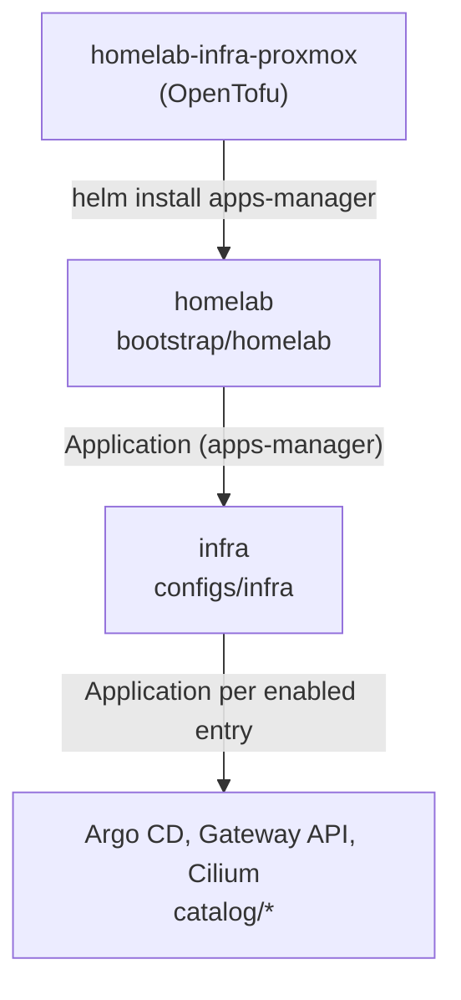

# homelab-apps

Declarative application catalog and Helm values for a homelab Kubernetes cluster, managed with [Argo CD](https://argo-cd.readthedocs.io/) using the app-of-apps pattern.

This repository is the source of truth for everything running in the cluster. The companion [`homelab-infra-proxmox`](https://github.com/jkososki/homelab-infra-proxmox) repository provisions the cluster and installs the initial platform from the values files here. After that, Argo CD watches this repository and reconciles the cluster against it.

## Overview

The repository holds no Kubernetes manifests of its own. It contains Helm values that are consumed by the [`apps-manager`](https://github.com/jkososki/charts/tree/main/charts/apps-manager) chart, which renders Argo CD `Application`, `AppProject`, and repository resources from them.



Applications are organized in three tiers:

| Tier        | Path          | Purpose |
| ----------- | ------------- | ------- |
| Bootstrap   | `bootstrap/`  | The root app-of-apps, installed once by `homelab-infra-proxmox`. It creates the `management` project and one Argo CD application per group in `configs/`. |
| Groups      | `configs/`    | Groups of related applications. Each group is an `apps-manager` release that declares its applications, their charts and versions, and the Argo CD project they belong to. |
| Catalog     | `catalog/`    | Helm values for each individual application, referenced from a group by `valuesPath`. |

## Repository layout

```text
.
├── bootstrap/
│   └── homelab/              # Root app-of-apps (installed by homelab-infra-proxmox)
├── configs/
│   ├── infra/                # Platform components: Argo CD, Gateway API, Cilium
│   └── apps/                 # Workload applications (reserved)
├── catalog/
│   ├── argocd/               # Argo CD
│   ├── cilium/               # Cilium CNI and kube-proxy replacement
│   ├── cilium-resources/     # LB IP pool, L2 announcements, shared Gateway
│   └── gateway-api/          # Gateway API CRDs
└── .pre-commit-config.yaml
```

Every directory under `bootstrap/`, `configs/`, and `catalog/` follows the same structure:

```text
<component>/
├── base.values.yaml          # Defaults shared by every environment
└── env/
    └── <env>.values.yaml     # Environment-specific overrides
```

## Configuration model

### Layered values

`apps-manager` generates multi-source Argo CD applications. The chart comes from its Helm or OCI registry, and the values come from this repository, referenced as `$values`. Each application receives two values files, applied in order:

1. `<valuesPath>/base.values.yaml`
2. `<valuesPath>/env/<valuesEnv>.values.yaml`

Helm merges the override file over the base, so an environment file only needs the keys it changes. The environment is selected by the `valuesEnv` key in each group's `env/<env>.values.yaml`.

For upstream charts such as Argo CD and Cilium, `base.values.yaml` is a copy of the chart's default `values.yaml` at the pinned version. Local customizations belong in the environment file. This keeps upgrades easy to review: refresh the base file from the new chart release, then diff it against the previous version.

### Declaring applications

A group's `base.values.yaml` defines its projects, repositories, and applications:

```yaml
applications:
  cilium:
    name: cilium
    prefix: ""
    project: infrastructure
    valuesRepo: homelabApps
    valuesPath: catalog/cilium
    chart:
      oci: oci://quay.io/cilium/charts/cilium   # or: name + registry for a Helm repository
      targetRevision: 1.20.3
    destination:
      namespace: kube-system
      cluster: local
```

Declaring an application does not deploy it. An application is only rendered when its key appears in `enabledApplications` in the environment file:

```yaml
# configs/infra/env/proxmox.values.yaml
valuesEnv: proxmox
enabledApplications:
  - argocd
  - gateway_api
  - cilium
```

Generated applications sync automatically with pruning enabled and use the `CreateNamespace=true` and `ServerSideApply=true` sync options by default. These can be extended per application through `syncPolicy`. See the [`apps-manager` chart](https://github.com/jkososki/charts/tree/main/charts/apps-manager) for the full set of options.

### Repositories

Repository entries are set to `create: false`, so `apps-manager` does not create Argo CD repository secrets for them. The entries are still used to resolve chart registries (`chart.registry`) and the values repository (`valuesRepo`).

### Adding an environment

1. Add `env/<env>.values.yaml` to `bootstrap/homelab` with `valuesEnv: <env>` and the groups to enable.
2. Add `env/<env>.values.yaml` to each enabled group in `configs/`, listing its `enabledApplications`.
3. Add `env/<env>.values.yaml` to each enabled application in `catalog/`. The file must exist, even if it is empty.
4. Configure the new environment in [`homelab-infra-proxmox`](https://github.com/jkososki/homelab-infra-proxmox#adding-an-environment).

## Making changes

All changes are made through Git. Argo CD picks them up from the `main` branch.

### Changing an application's configuration

Edit the relevant `catalog/<component>/env/<env>.values.yaml` file and merge it to `main`.

### Upgrading a chart

1. Update `chart.targetRevision` for the application in its group's `base.values.yaml`.
2. Replace `catalog/<component>/base.values.yaml` with the default values from the new chart version.
3. Review the upstream changes and adjust the environment overrides as needed.
4. If the component is also installed at bootstrap, update the pinned version in `homelab-infra-proxmox` so new clusters start on the same release.

### Adding an application

1. Create `catalog/<component>/base.values.yaml` and `catalog/<component>/env/<env>.values.yaml`.
2. Declare the application under `applications` in the appropriate group's `base.values.yaml`.
3. Add its key to `enabledApplications` in the group's environment file.

### Adding a group

1. Create `configs/<group>/base.values.yaml` with its projects, repositories, and applications, and `configs/<group>/env/<env>.values.yaml`.
2. Declare the group as an application of the `apps-manager` chart in `bootstrap/homelab/base.values.yaml`.
3. Add it to `enabledApplications` in `bootstrap/homelab/env/<env>.values.yaml`.

### Previewing rendered output

Render a group locally to check the generated Argo CD resources before pushing:

```sh
helm repo add homelab-charts https://jkososki.github.io/charts
helm template infra homelab-charts/apps-manager --version 0.1.9 \
  -f configs/infra/base.values.yaml \
  -f configs/infra/env/proxmox.values.yaml
```

## Development

This repository uses [prek](https://prek.j178.dev/) to run its pre-commit hooks:

```sh
prek install
prek run --all-files
```

The hooks cover YAML validation, secret detection ([Betterleaks](https://github.com/betterleaks/betterleaks)), large file checks, and general file hygiene.

> [!IMPORTANT]
> This is a public repository. Never commit secrets, tokens, or credentials. Sensitive values must be provided to the cluster by other means.

## Related repositories

- [`homelab-infra-proxmox`](https://github.com/jkososki/homelab-infra-proxmox): provisions the Talos Kubernetes cluster on Proxmox VE and bootstraps Argo CD from this repository.
- [`charts`](https://github.com/jkososki/charts): Helm charts used here, including `apps-manager`, `gateway-api`, and `raw`.

## License

Released under the [MIT License](LICENSE).
